# CompileCraft

**An Educational Multi-Language Compiler and Interactive Desktop IDE**

CompileCraft is a modular compiler front-end suite, Three-Address Code (TAC) Virtual Machine, and cross-file Electron desktop IDE built in C, Flex, Bison, TypeScript, React, and Monaco Editor. Dedicated C, C++, and Java front ends parse bounded educational language subsets into a unified Abstract Syntax Tree (AST), scoped Symbol Table, six-rule Semantic Analyzer, TAC generator, and built-in interactive TAC Virtual Machine.

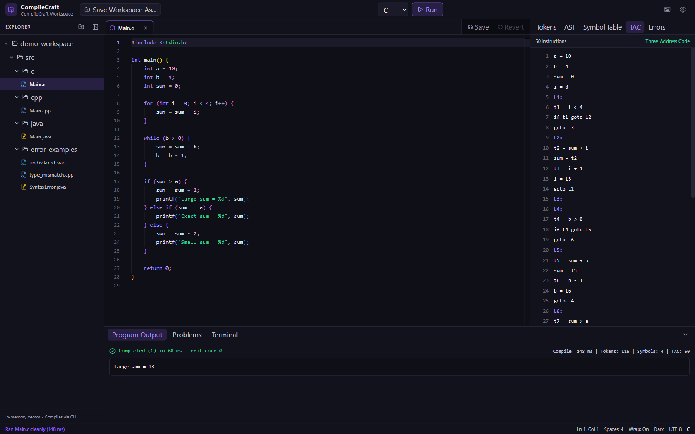

---

## Table of Contents

- [Project Overview](#project-overview)
- [Screenshots](#screenshots)
- [Key Features](#key-features)
- [Supported Languages](#supported-languages)
- [Architecture](#architecture)
- [Technology Stack](#technology-stack)
- [Installation and Setup](#installation-and-setup)
- [Running CompileCraft](#running-compilecraft)
- [Testing](#testing)
- [Project Limitations](#project-limitations)
- [Project Structure](#project-structure)
- [Future Development](#future-development)
- [Author and License](#author-and-license)

---

## Project Overview

CompileCraft was designed to demonstrate how multiple source languages can share a single compiler middle-end and execution runtime without delegating to external compilers (`gcc`, `g++`, or `javac`):

- **Multi-Language Front-Ends**: Separate Flex lexers and Bison LALR(1) parsers for **C**, **C++**, and **Java** subsets (alongside a baseline `.mc` educational mini-language) lower directly into a shared AST representation.
- **Unified Middle-End**: A single Symbol Table, Semantic Analyzer, and TAC generator validate scope, types, and expressions uniformly across all front ends before producing line-annotated Three-Address Code.
- **Built-In TAC Virtual Machine**: The `src/vm/` runtime executes verified TAC programs directly with support for interactive standard input (`scanf`, `cin`, `Scanner`), formatted output, runtime diagnostics, and bounded infinite-loop protection.
- **Desktop IDE**: An Electron + React + Monaco desktop application invokes `bin/compilecraft.exe` via hardened IPC (`contextIsolation: true`, `nodeIntegration: false`, `sandbox: true`) to stream live program I/O, inspect Tokens/AST/Symbol Table/TAC, navigate errors, organize folders, and persist workspaces to disk.

---

## Screenshots

### Dark & Light Themes

| Dark Theme | Light Theme |
|---|---|
|  | 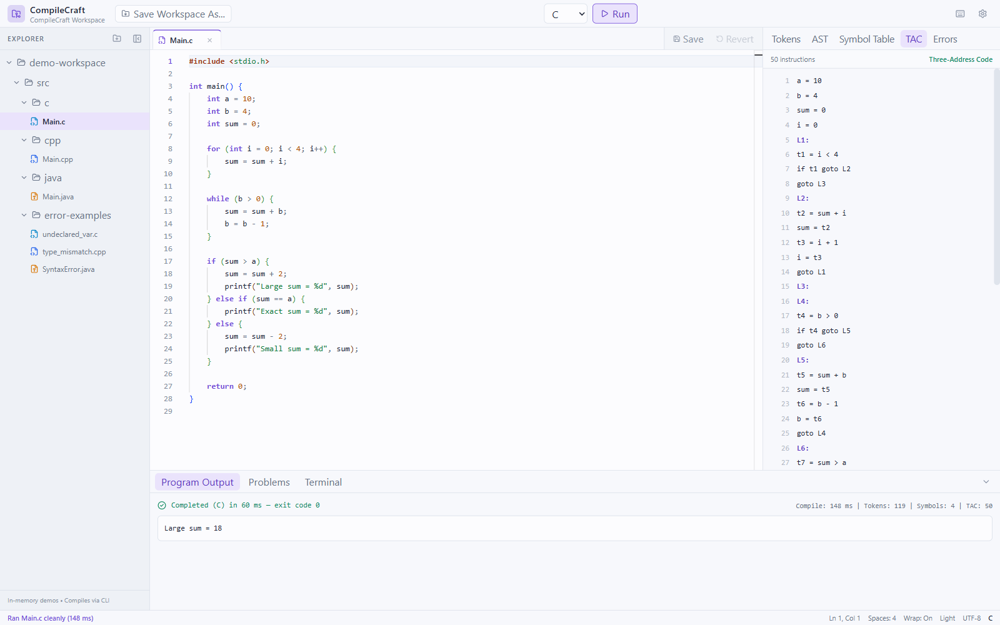 |

### Language Pipelines (C, C++, Java)

| C Compiler (`Main.c` + Symbol Table) | C++ Compiler (`cin` + TAC) |
|---|---|
| 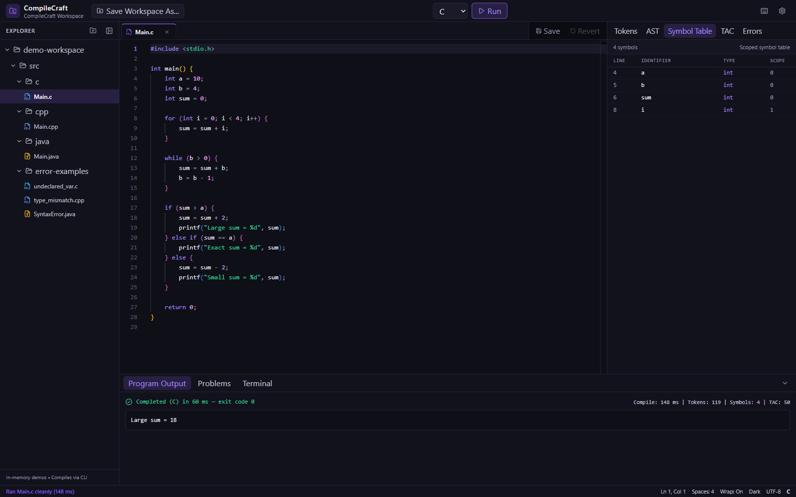 | 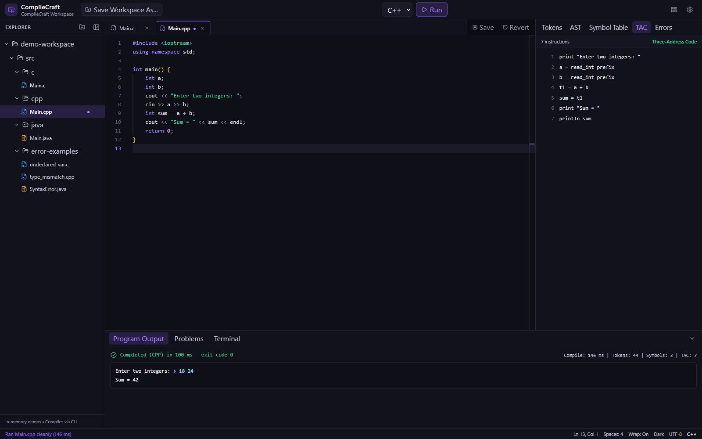 |

| Java Compiler (`Scanner` + AST) | Interactive Console (`stdin` / `stdout`) |
|---|---|
| 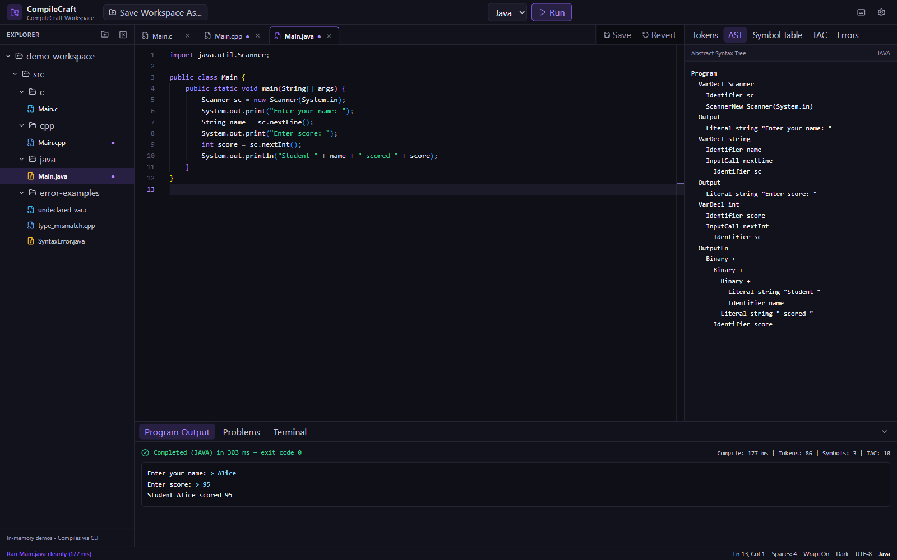 | 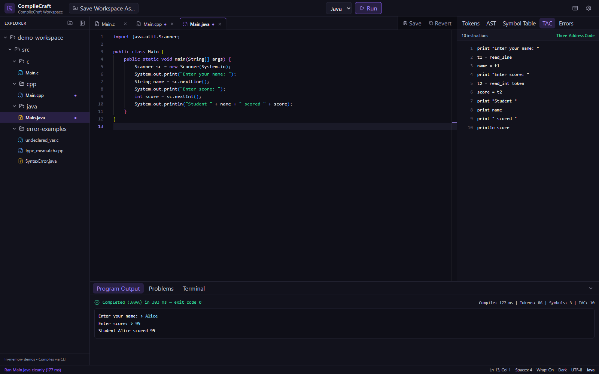 |

### Diagnostics, Workspace Management & Customization

| Diagnostics & Error Navigation | Nested Folders & Workspace Explorer |
|---|---|
| 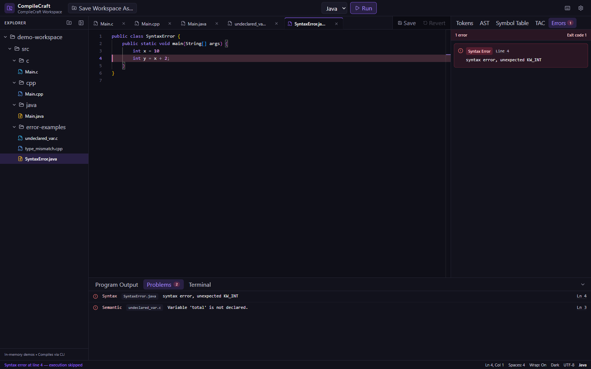 | 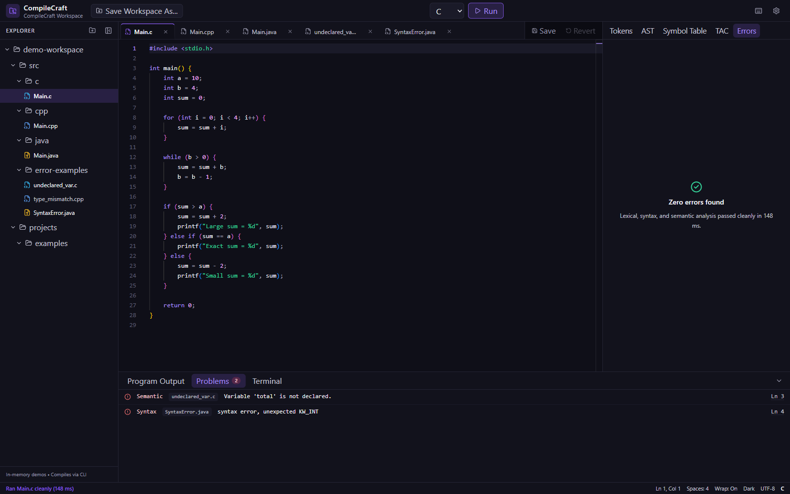 |

| Editor & Theme Settings | Saved Disk Workspace Persistence |
|---|---|
| 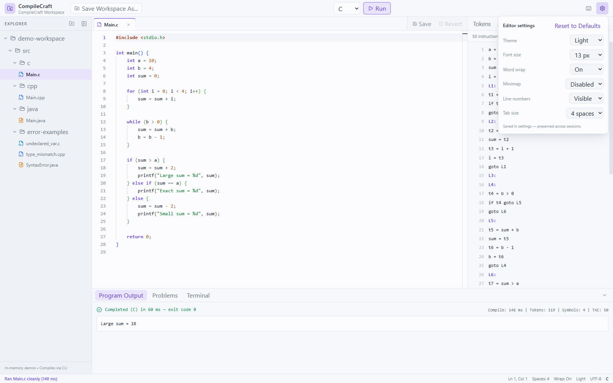 | 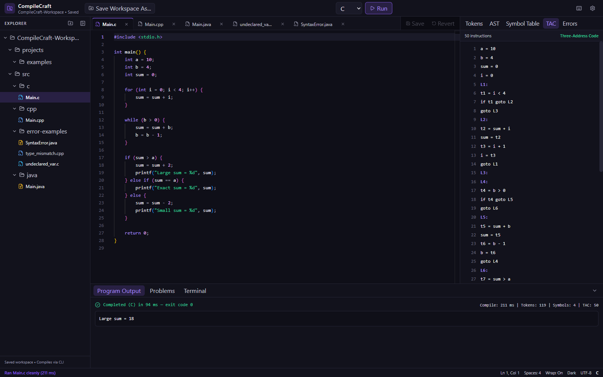 |

---

## Key Features

### Compiler Features
- **Dedicated Front-Ends**: Flex scanners and conflict-free Bison LALR(1) parsers (`-Werror=conflicts-sr -Werror=conflicts-rr`) for C, C++, Java, and baseline `.mc`.
- **Shared AST & Scoped Symbol Table**: Deterministic tree construction with strict ownership/cleanup and block-scoped symbol resolution.
- **Six-Rule Semantic Analysis**: Enforces undeclared-variable, same-scope redeclaration, loop/block scope, type-mismatch, invalid-assignment (such as narrowing `float` to `int`), and invalid-expression checks with source line numbers.
- **TAC Generation & Virtual Machine**: Emits Three-Address Code (`t1, t2, ...`, `L1, L2, ...`) and executes it inside CompileCraft's own TAC VM (`--run`) with tagged `int`/`float`/`bool`/`string` values, runtime error trapping, and a `1,000,000`-step execution cap.

### Interactive Execution
- **C `scanf`**: Supports `%d`, `%f`, `%s`, `%Ns`, `%%`, literal/whitespace matching, and buffer-width validation.
- **C++ `cin`**: Supports `cin >> ...` and chained `std::cin >> a >> b;` for `int`, `float`, `bool` (`0`/`1`), and `string`.
- **Java `Scanner`**: Supports `new Scanner(System.in)` with `nextInt()`, `nextFloat()`, `nextBoolean()`, `next()`, and `nextLine()`.
- **Streaming Console**: Persistent child-process execution over `stdin`/`stdout`/`stderr` pipes with Enter-to-submit input, **Send EOF**, and **Stop** controls.

### Desktop IDE
- **Monaco Editor**: Syntax highlighting for C, C++, and Java, per-tab view-state preservation, configurable font size, tab size, word wrap, line numbers, and minimap.
- **Run & Shortcuts**: Unsaved buffer execution via **Run** or `Ctrl+Enter` (`Cmd+Enter` on macOS), plus `Ctrl+S` save and tab-cycling shortcuts.
- **File & Folder Management**: Explorer tree with inline **Rename** (preserving extensions and validating Windows naming rules), **New Folder** (root and nested), drag-and-drop or context-menu **Move to folder**, and default `Main.c`, `Main.cpp`, `Main.java`, plus `error-examples/`.
- **Save Workspace As & Persistence**: Native directory picker defaulted to Desktop (`app.getPath('desktop')`), project folder creation (`CompileCraft-Workspace`), overwrite confirmation for non-empty directories, physical **Save** / disk **Revert**, and automatic workspace reopening on restart.
- **UX & Navigation**: Light/Dark theme persistence, resizable Explorer, Analysis, and Bottom panels with saved sizes, and clickable workspace-wide diagnostic navigation that switches files, scrolls to the line, highlights it, and focuses the editor.

---

## Supported Languages

CompileCraft implements **bounded educational subsets** of C, C++, and Java rather than full ISO C, ISO C++, or standard Java specifications.

| Aspect | C Subset (`C_Compiler/`) | C++ Subset (`CPP_Compiler/`) | Java Subset (`Java_Compiler/`) |
|---|---|---|---|
| **Entry & Header** | `#include <stdio.h>`, `int main()` / `int main(void)` | `#include <iostream>`, `#include <string>`, optional `using namespace std;`, `int main()` | Optional `import java.util.Scanner;` / `import java.util.*;`, `[public] class Name { public static void main(String[] args) }` |
| **Data Types** | `int`, `float`, `_Bool` / `bool`, fixed `char buf[N]` | `int`, `float`, `bool`, `string` / `std::string` | `int`, `float`, `boolean`, `String`, `Scanner` |
| **Control Flow** | Blocks, `if` / `else if` / `else`, `while`, `for`, `++`/`--` | Blocks, `if` / `else if` / `else`, `while`, `for`, `++`/`--` | Blocks, `if` / `else if` / `else`, `while`, `for`, `++`/`--` |
| **Output** | `printf(...)` (`%d`, `%f`, `%.Nf`, `%s`, `%%`) | `cout` / `std::cout << ...`, `endl` / `std::endl` | `System.out.print(...)`, `System.out.println(...)`, `Binary +` string concatenation |
| **Interactive Input** | `scanf(...)` (`%d`, `%f`, `%s`, `%Ns`, `%%`) | `cin` / `std::cin >> ...` (single & chained) | `Scanner` (`nextInt`, `nextFloat`, `nextBoolean`, `next`, `nextLine`) |
| **Subset Limitations** | No structs, pointers (except `&var` in `scanf`), arrays beyond `char buf[N]`, user functions, `switch`, `break`/`continue`, `#define` | No classes, templates, STL containers, references, operator overloading, `std::getline`, `boolalpha`, `#define` | Single entry class/method only; no OOP methods/fields/inheritance, generics, arrays beyond `String[] args`, `try-catch`, or JVM bytecode |

---

## Architecture

### Compilation and Execution Pipeline

```text
Source Code → Lexer → Parser → AST → Symbol Table → Semantic Analysis → TAC → Virtual Machine → Program Output
```

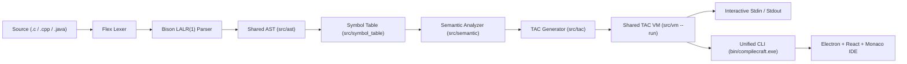

### Repository Component Roles

- `src/`: Unified CLI dispatcher (`main.c`), baseline `.mc` lexer/parser, shared AST core, scoped Symbol Table, Semantic Analyzer, TAC generator, and Shared TAC Virtual Machine (`src/vm/`).
- `C_Compiler/`, `CPP_Compiler/`, `Java_Compiler/`: Language-specific Flex specifications, Bison parsers, token tables, and standalone compiler drivers (`compilecraft-c.exe`, `compilecraft-cpp.exe`, `compilecraft-java.exe`).
- `frontend/`: Electron desktop host (`electron/main.cjs`, `preload.cjs`, `workspaceManager.cjs`), React/TypeScript UI (`src/`), and Electron CDP E2E test suites (`tests/`).
- `tests/`: Regression test runner (`run_tests.py`), C unit-test harnesses, Unified CLI tests, VM execution tests, and language/baseline golden suites.
- `docs/`: Technical architecture documents, language subset specifications, design decisions (`decisions.md`), and milestone roadmap (`roadmap.md`).

---

## Technology Stack

| Layer | Technologies |
|---|---|
| **Compiler & VM** | C (C11), GCC (MSYS2 UCRT64), Flex, Bison, GNU Make |
| **Desktop Host** | Electron, Node.js (`contextBridge`, `child_process.spawn`, `fs.promises`, `dialog`) |
| **Frontend UI** | TypeScript, React, Vite, Monaco Editor (`@monaco-editor/react`, `monaco-editor`), Tailwind CSS, Lucide Icons (`lucide-react`) |
| **Linting & Testing** | `oxlint`, Python (`tests/run_tests.py`, `tests/cli/test_cli.py`, `tests/vm/test_vm_execution.py`), Node.js CDP E2E scripts |

---

## Installation and Setup

### Prerequisites (Windows)

- **64-bit MSYS2 UCRT64 toolchain** (configured in `Makefile`):
  - `gcc` (C11)
  - `flex`
  - `bison`
  - `mingw32-make` (GNU Make)
- **Python 3** on `PATH` (for regression test runners)
- **Node.js & npm** (for the Electron desktop IDE)

### 1. Build the Compiler & VM Binaries

```powershell
mingw32-make toolchain-check
mingw32-make all
```

This builds `bin/compilecraft.exe`, the C/C++/Java front-end compilers, baseline `.mc` drivers, and C unit-test binaries.

### 2. Install Frontend Dependencies & Build the IDE Bundle

```powershell
npm --prefix frontend install
npm --prefix frontend run build
```

---

## Running CompileCraft

### Desktop IDE

Launch the Electron desktop IDE using the repository launcher or npm script:

```powershell
.\run_ide.bat
```

Or via npm:

```powershell
npm --prefix frontend run electron:start
```

### Command-Line Compiler

Use `bin/compilecraft.exe` for `.c`, `.cpp`, and `.java` files:

```powershell
# Compile and execute via Shared TAC VM
.\bin\compilecraft.exe --run tests\cli\valid_c.c
.\bin\compilecraft.exe --run tests\cli\valid_cpp.cpp
.\bin\compilecraft.exe --run tests\cli\ValidJava.java

# Inspect individual compilation stages
.\bin\compilecraft.exe --tokens tests\cli\valid_c.c
.\bin\compilecraft.exe --ast tests\cli\valid_cpp.cpp
.\bin\compilecraft.exe --symtab tests\cli\ValidJava.java

# Emit TAC without executing
.\bin\compilecraft.exe tests\cli\valid_c.c
```

For baseline `.mc` files, use the dedicated pipeline drivers (`bin\compilecraft-lexer.exe`, `bin\compilecraft-parser.exe`, `bin\compilecraft-semantic.exe`, `bin\compilecraft-tac.exe`).

---

## Testing

### Compiler, VM & CLI Suites

```powershell
# Full clean build + all C unit tests and automated regression suites
mingw32-make clean all test

# Run test suites without cleaning
mingw32-make test
```

Verified passing counts:
- **540 / 540** automated compiler, VM, and CLI regression cases across 21 suites (including 56 Unified CLI tests and 44 VM execution tests)
- **4 / 4** C unit-test executables (`test-ast-list-ownership`, `test-symbol-table`, `test-tac`, `test-vm`)

### Frontend Build, Lint & Electron E2E Suites

```powershell
npm --prefix frontend run build
npm --prefix frontend run lint

node frontend/tests/e2e_interactive_console.mjs
node frontend/tests/e2e_file_rename.mjs
node frontend/tests/e2e_ux_refinements.mjs
node frontend/tests/e2e_workspace_management.mjs
```

Verified passing counts:
- **Frontend build**: `tsc -b && vite build` passed (`0` errors)
- **Frontend lint**: `oxlint src` passed (`0 warnings, 0 errors`)
- **Interactive Console E2E** (`e2e_interactive_console.mjs`): **16 / 16** passed
- **File Rename E2E** (`e2e_file_rename.mjs`): **9 / 9** passed
- **UX Refinements E2E** (`e2e_ux_refinements.mjs`): **4 / 4** passed
- **Workspace Management E2E** (`e2e_workspace_management.mjs`): **5 / 5** passed

---

## Project Limitations

- **Educational Language Subsets**: None of the front ends implement full ISO C, ISO C++, or standard Java specifications (see `docs/c_frontend.md`, `docs/cpp_frontend.md`, and `docs/java_frontend.md`).
- **Unified Simplified Scope & Initializer Model**: Initializers are evaluated before inserting a newly declared variable into the current block scope (`{ int x = x + 1; }` resolves the RHS `x` to an enclosing scope), and Java local block shadowing is permitted unlike strict JLS §6.4.
- **Logical Operators (`DEC-07`)**: `&&` and `||` currently use eager TAC evaluation rather than short-circuit branching.
- **VM Execution Only**: CompileCraft executes verified TAC on its internal Virtual Machine rather than generating native x86/ARM binaries or JVM classfiles. Execution is capped at `1,000,000` VM steps to trap infinite loops safely.
- **Packaging**: Electron runs from the local workspace (`electron .` / `run_ide.bat`); standalone Windows installer packaging (M14) is not yet bundled.

---

## Project Structure

```text
CompileCraft/
├── .gitignore
├── Makefile
├── README.md
├── run_ide.bat
├── assets/
│   └── screenshots/             # Genuine Electron IDE captures used in README.md
├── C_Compiler/                  # C-subset Flex lexer, Bison parser, and CLI driver
├── CPP_Compiler/                # C++-subset Flex lexer, Bison parser, and CLI driver
├── Java_Compiler/               # Java-subset Flex lexer, Bison parser, and CLI driver
├── docs/                        # Architecture, grammar, frontend, TAC, VM, and roadmap specs
├── frontend/                    # Electron + React + TypeScript + Monaco desktop IDE
│   ├── electron/                # Main process, preload bridge, and workspace persistence
│   ├── public/                  # App icon assets
│   ├── src/                     # React UI, Monaco integration, Explorer, and IPC services
│   └── tests/                   # Electron CDP E2E test suites
├── src/                         # Unified CLI, baseline .mc front end, AST, Symtab, Semantic, TAC, VM
└── tests/                       # C unit tests, Python regression runners, and golden suites
```

---

## Future Development

- **Desktop Installer Packaging (M14)**: Package standalone Windows distributables bundling `bin/compilecraft.exe` and Electron assets.
- **Short-Circuit Logical Codegen (`DEC-07`)**: Upgrade `&&` and `||` TAC generation from eager evaluation to short-circuit control-flow lowering.
- **Expanded Language Coverage**: Incremental support for user-defined functions, multi-dimensional arrays, `break`/`continue`/`switch`, and compound assignments within the shared IR.

---

## Author and License

- **Repository**: [ak1bhasan/CompileCraft](https://github.com/ak1bhasan/CompileCraft)
- **License**: No explicit license file is currently present in the repository.
