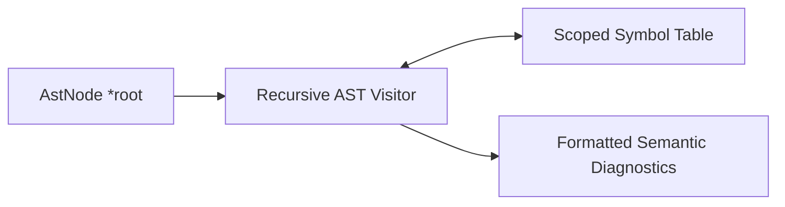

# CompileCraft Semantic Analysis & Type Checking

> **Milestone**: 6 — Semantic Analysis (M6)  
> **Status**: Completed & Verified  
> **Code Location**: `src/semantic/` (`semantic.h`, `semantic.c`, `main.c`)  
> **Target Executable**: `bin/compilecraft-semantic.exe`  
> **Tests**: `tests/semantic/` (26 regression tests)

---

## 1. Overview & Architecture

The Semantic Analyzer recursively traverses the Abstract Syntax Tree (AST) generated by the Bison parser, interacts with the Scoped Symbol Table (M5), and validates semantic constraints that cannot be expressed in Context-Free Grammars.

The analyzer runs across all declaration, assignment, expression, and control statements in the program, accumulating errors without terminating early, and returns `0` on clean success or `1` if semantic violations are discovered.

---

## 2. Six Mandatory Faculty Rules

The analyzer strictly enforces the six required semantic rules:

| Rule | Category | Description | Diagnostic Format |
|---|---|---|---|
| **Rule 1** | Undeclared Variable | Using an identifier in an expression or assignment without prior declaration in accessible scopes | `Semantic Error at line <line>: Variable '<name>' is not declared.` |
| **Rule 2** | Redeclaration | Declaring an identifier with the same name more than once within the exact same lexical scope frame | `Semantic Error at line <line>: Variable '<name>' is already declared in this scope.` |
| **Rule 3** | Scope Violation | Attempting to access an identifier declared inside an inner block that has already exited its lifetime | `Semantic Error at line <line>: Scope violation: Variable '<name>' declared at line <decl_line> is not accessible in this scope.` |
| **Rule 4** | Type Mismatch | Incompatible types in declarations, condition comparisons, or equality checks between booleans and numeric values | `Semantic Error at line <line>: Type mismatch: 
.` |
| **Rule 5** | Invalid Assignment | Assigning an expression of an incompatible type (e.g. float to int narrowing, or bool to int/float) | `Semantic Error at line <line>: Invalid assignment: 
.` |
| **Rule 6** | Invalid Expressions | Applying operators to invalid operand domains (e.g. logical operators on numbers, float modulo, ordering on booleans) | `Semantic Error at line <line>: Invalid expression: 
.` |

---

## 3. Type Checking & Language Rules

### 3.1 Type Evaluation & Promotion (DEC-02)
- **Basic Types**: `int`, `float`, and `bool`.
- **Numeric Widening**: In mixed arithmetic (`int + float`), integer operands are promoted to `float`, producing a `float` result.
- **Narrowing Forbidden**: Assigning a `float` expression to an `int` variable without an explicit cast is rejected under Rule 5.
- **Boolean Isolation**: `bool` is strictly non-numeric. It cannot be converted, added, subtracted, or compared via ordering operators (`<`, `>`, `<=`, `>=`).

### 3.2 Modulo Operator (DEC-03)
- Modulo (`%`) is strictly restricted to integer operands (`int % int -> int`).
- Applying `%` to `float` or `bool` operands is rejected under Rule 6.

### 3.3 Equality Operators on Booleans (DEC-04)
- `==` and `!=` are valid for boolean operands (`bool == bool -> bool`).
- Comparing `bool` against numeric types (`bool == int`) is rejected under Rule 4.

### 3.4 Control Flow Conditions (DEC-05)
- Conditions in `if` and `while` statements must evaluate to `bool`.
- Numeric conditions (e.g. `if (10)`) are rejected under Rule 6.

---

## 4. Test Suite Coverage

The test suite in `tests/semantic/` covers 26 test cases:

- **Valid Programs (8 cases)**:
  - `01_var_declarations.mc`: Variable declarations and initializations.
  - `02_assignments.mc`: Valid target assignments.
  - `03_arithmetic_expressions.mc`: Complex algebraic expressions and mixed promotions.
  - `04_relational_expressions.mc`: Relational comparisons producing booleans.
  - `05_logical_expressions.mc`: Boolean logic combinations with `&&`, `||`, `!`.
  - `06_control_flow.mc`: `if-else` and `while` loops with boolean predicates.
  - `07_nested_blocks_scope.mc`: Nested scope visibility and variable shadowing.
  - `08_sample_program.mc`: Full Section 5.5 authoritative sample program.
- **Negative Error Cases (14 cases)**:
  - 2 tests for Rule 1 (undeclared in expression, undeclared in assignment target).
  - 2 tests for Rule 2 (duplicate declaration in same scope, different types).
  - 2 tests for Rule 3 (accessing block variable outside block, while-loop variable outside).
  - 2 tests for Rule 4 (initializing bool with numeric, comparing bool with int).
  - 3 tests for Rule 5 (float to int assignment, bool to int, int to bool).
  - 7 tests for Rule 6 (logical op on numbers, NOT on number, arithmetic on bool, float modulo, ordering on bool, numeric if condition, numeric while condition).
